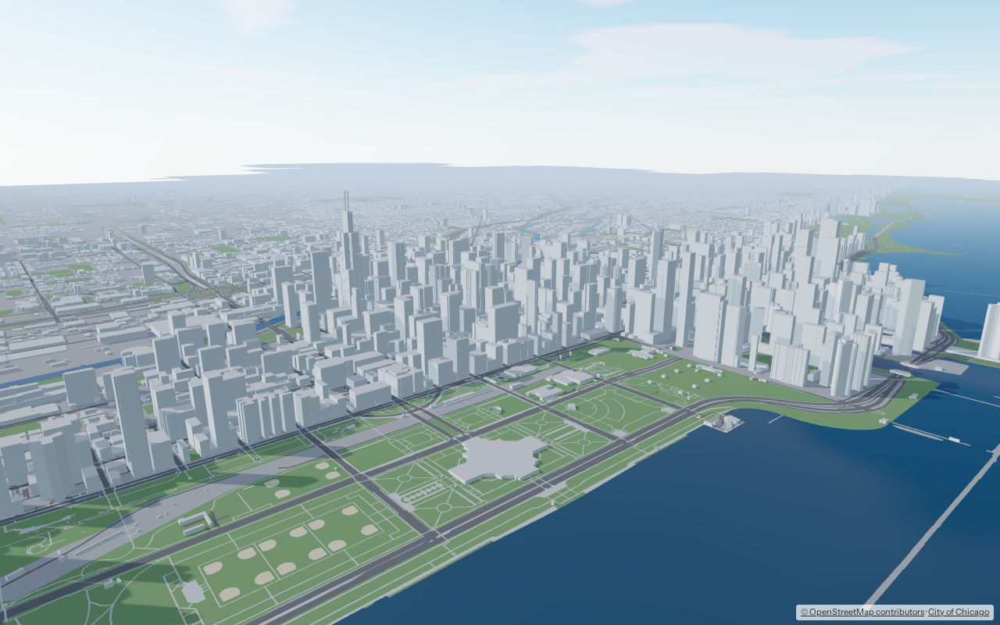
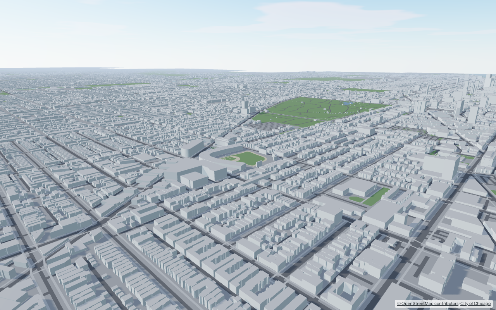
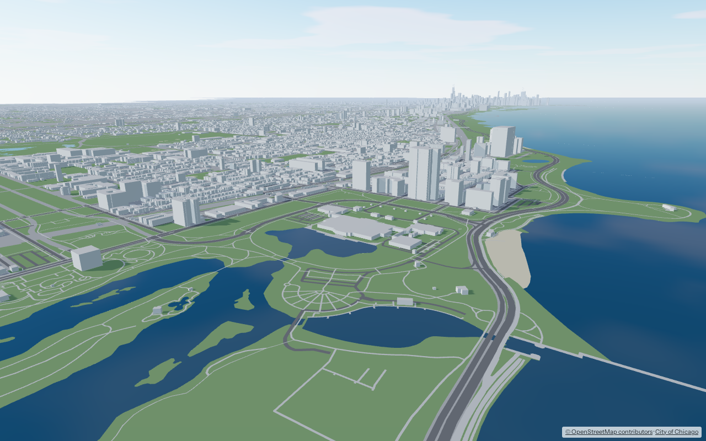
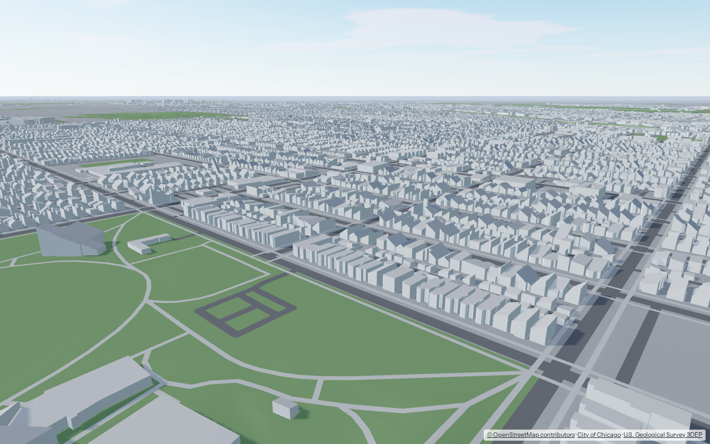
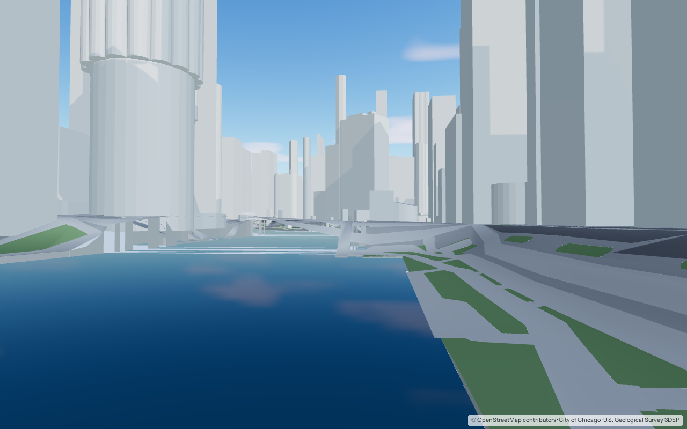
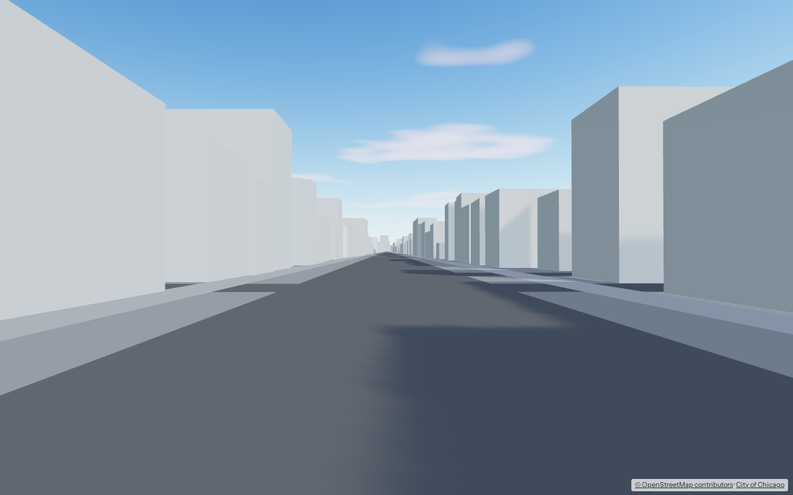
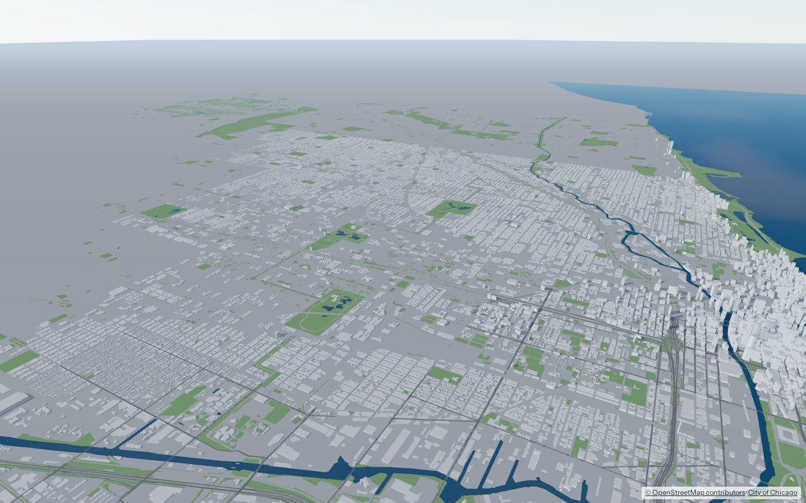

# Chicago Interactive Map

A 3D map of Chicago you can walk through in a browser, built only from open data and open-source tools.



**Status: phase 2 is complete.** All 77 community areas are built: 843,340 buildings, 95% of them with heights measured by lidar and 704,898 with real roof shapes (gables, hips, setbacks), standing on real ground elevation. Streets, paths, parks, the river and Lake Michigan complete the map. You can fly over the city like a map or walk through any neighborhood at street level.

| | |
|---|---|
|  |  |
|  |  |
|  |  |

## Quick start

You need **Docker** and **bash**. Everything else runs in containers.

```bash
./dev build all  # download sources and build the whole city (about 3.5 hours the first time)
./dev app        # start the viewer
```

The first full build downloads about 13 GB (mostly lidar) and needs about 20 GB of disk plus about 3 GB of Docker images. Most of the time goes to roofer, about 2.5 hours on 28 cores. After that, downloads and roofs are cached, and a rebuild of the tiles takes about 17 minutes. The tiles themselves are 1.5 GB. It needs a machine with 32 GB of memory at the default settings (see `pipeline/config.yaml`). To try it faster, `./dev build` builds only the Loop (about 5 minutes).

Open <http://localhost:5173>.

| Mode | Controls |
|---|---|
| **Map** | Drag to pan. Right-drag or two fingers to tilt and turn. Scroll or pinch to zoom. Click a building to see its height, where the height came from, and its OpenStreetMap link. |
| **Walk** | W A S D or arrow keys to walk, Shift to go faster. Click the view to look around with the mouse; Esc releases it. On a phone, use the circle at bottom left to walk and drag elsewhere to look. You can't walk through buildings. |

The panel shows which community area you're in. Pick one under **Go to** to jump there, or click the minimap. Viewpoints from [`eval/viewpoints.json`](eval/viewpoints.json) open with `?view=<name>`, for example <http://localhost:5173/?view=riverwalk>.

### Other commands

```bash
./dev build 32,8        # build several community areas (Loop + Near North Side)
FORCE=1 ./dev build all # rebuild tiles even if Snakemake thinks they're current
./dev areas             # list all 77 community area numbers
./dev test              # pipeline tests and TypeScript check
./dev smoke             # click-a-building and walk-into-a-wall test in headless Chromium
./dev share             # public link via a Cloudflare quick tunnel (production build); ./dev unshare stops it
./dev eval              # screenshot every viewpoint into eval/out/ and check render budgets
./dev eval riverwalk    # just one viewpoint
./dev clean             # delete intermediate files and builds (downloads are kept)
```

## How it works

```
sources.yaml ──fetch──► data/raw/        downloads, recorded in sources.lock.json
                          │
                          ▼
             pipeline (Python, in Docker, run by Snakemake)
               osm        cut Chicago out of the Illinois OpenStreetMap extract
               buildings  footprints + heights per community area, joined with City of Chicago attributes
               lidar      per 2 km block: ground elevation model (2 m), roof heights per footprint,
                          building points the map doesn't have (USGS 3DEP, 2017)
               roofs      per 2 km block: LoD 2.2 roof shapes with roofer
               rail       per 2 km block: deck heights of elevated track, sampled from lidar
               trees      per 2 km block: tree positions, heights and crowns from lidar
               tiles      per 2 km block, in parallel: ground draped over the terrain, buildings
                          with lidar heights and roofs, written as a level-of-detail quadtree
                          │
                          ▼
                     data/builds/<build>/   tileset.json, tiles/<level>/*.glb, minimap.webp,
                                            report.json, accuracy.json
                          │
                          ▼
             app (three.js + 3DTilesRendererJS, Vite)   map and walk modes in the browser
```

- **Community areas are the unit of work.** Chicago has 77 official community areas. `./dev build 32` builds only the Loop, and `./dev build all` builds the city. Buildings are placed when their center falls inside a built area. Ground layers extend two tiles (1 km) past the edge, so the lake and parks don't stop at the boundary.
- **Level of detail.** The smallest tiles (500 m) hold every building and every street. Each level up doubles the tile size and keeps less: first only bigger buildings and major roads, eventually just tall towers, water and parks. As the camera gets closer, the viewer swaps each tile for its four more detailed children, so full detail loads only within about a kilometer. Vertex data is quantized (`KHR_mesh_quantization`) to keep tiles small.
- **Heights come from lidar.** The 2017 USGS survey of Cook County is read straight from its public cloud copy, at about 4 points per m² (a quarter of full density), and only for the blocks being built. A building's height is the 95th percentile of the lidar points on its roof, minus the lowest ground under it. Mapped heights are kept where lidar can't be trusted: floating parts, building parts with an explicit OpenStreetMap height, and footprints mostly covered by other footprints, where lidar only sees the top one. Buildings without enough lidar points fall back to OpenStreetMap height, OpenStreetMap floor count, City of Chicago floor count, then a default by type. The building card shows the source and the height before lidar.
- **Roof shapes** come from [roofer](https://github.com/3DBAG/roofer), the open-source tool behind the Dutch national 3D building dataset (3DBAG). It finds the roof planes in each footprint's points, so houses get gables and hips, and towers get their setbacks. It runs as a separate program (GPL-3.0).
- **Terrain.** Streets, parks and land are draped over a 2 m ground model built from the lidar's ground points, plus bridge decks so roads stay on their bridges. Triangles are refined only where the ground departs from a plane. The river and lake are flat at water level (176.5 m), with walls up to the banks, left open under bridges. Buildings start at the ground under them.
- **The L.** The track alignment comes from OpenStreetMap (CTA lines are `railway=subway`, one line per track). Elevated sections get a steel deck, girders and columns every 13 m, standing outside each pair of tracks. Deck heights are sampled from the lidar's top surface every 4 m, so the structure rises and falls like the real one. Platforms sit at deck height with canopies. Metra and freight lines get a railbed strip at ground level and a deck on their bridges.
- **Trees** are found in the lidar: vegetation points outside building footprints make a 1 m canopy-height grid, and its peaks are tree tops. Each tree gets its measured height and a crown size estimated from it. Species aren't known, because Chicago has no openly licensed tree inventory, so trees use a few generic low-poly shapes. Coarser tiles keep only the taller trees.
- **Overrides.** Fixes to the generated map live in `data/overrides/<area>.yaml`: set a height, hide a building, force a flat roof, or add a missing building, each with a reason and evidence. The format is documented at the top of `pipeline/cim/overrides.py`.
- **Accuracy report.** Every build writes `accuracy.json`. It compares the pre-lidar heights with lidar for each source and lists, per community area, the largest disagreements, footprints where the lidar sees nothing (maybe demolished), and clusters of building points with no footprint (maybe missing from the map). These are the starting point for the neighborhood walk's verify pass.
- **Coordinates.** Everything is in meters from **State & Madison**, the zero point of Chicago's street address grid: x east, y north, z up. Tilesets carry the transform to Earth-centered coordinates, so other 3D Tiles viewers such as Cesium should be able to place them (not yet tested).
- **Builds are immutable folders.** `data/builds/manifest.json` says which one the viewer loads.

### Where things live

| What | Where |
|---|---|
| Code, config, viewpoints, agent progress | this repository |
| Source list with licenses | [`sources.yaml`](sources.yaml); exact files used in [`sources.lock.json`](sources.lock.json) |
| Downloads, intermediate files, tile builds | `data/` (not committed; rebuilt by the pipeline) |
| Progress of the neighborhood-by-neighborhood work | [`agent/state/areas.yaml`](agent/state/areas.yaml) |

## Data and licenses

| Source | Used for | License |
|---|---|---|
| [OpenStreetMap](https://www.openstreetmap.org/copyright), via the [Geofabrik](https://download.geofabrik.de/) Illinois extract | Buildings, streets, paths, water, parks | ODbL 1.0 · © OpenStreetMap contributors |
| [City of Chicago building footprints](https://data.cityofchicago.org/d/syp8-uezg) | Floor counts, year built, names, buildings missing from OSM | City of Chicago Data Portal Terms of Use |
| [City of Chicago community areas](https://data.cityofchicago.org/d/igwz-8jzy) | Build units and boundaries | City of Chicago Data Portal Terms of Use |
| [USGS 3DEP lidar, Cook County 2017](https://www.usgs.gov/3d-elevation-program) ([on AWS](https://registry.opendata.aws/usgs-lidar/)) | Building heights, roof shapes, ground elevation | Public domain |

The viewer shows attribution for every source. Google and Apple map content (Street View, Look Around, Google 3D Tiles) is **not** used anywhere, not even as visual reference. Their terms forbid building map data from it. See [AGENTS.md](AGENTS.md#data-sources).

The project doesn't have a code license yet. Choose one before publishing the repository.

## Roadmap

| Phase | What | Status |
|---|---|---|
| 0 | Repo, Docker pipeline, source manifest, coordinate frame, viewpoint screenshots | Done |
| 1 | Simple blocks for buildings, streets, water and parks across all 77 areas; map and walk modes; minimap; level of detail | **Done** |
| 2 | Accurate heights and roof shapes from USGS lidar; real ground elevation; accuracy report | **Done** |
| 3 | Citywide generators for the L (track, elevated structure, stations) and trees; overrides; first neighborhood-walk pass that checks each area | **In progress:** L, trees and overrides done; agent pass next |
| 4 | Realistic rendering (materials, windows, reflections, sky; see [`demos/facade-layers.html`](demos/facade-layers.html)); facade recipes from Mapillary and KartaView photos | Planned |
| 5 | Live L trains, landmark photo captures, an in-app "report a problem" button, iOS and Android apps via Capacitor | Planned |

## Repository layout

```
dev                    task runner (bash)
docker-compose.yml     pipeline, web (viewer) and eval containers
sources.yaml           every data source, with license
pipeline/              Python package `cim`, Snakefile, config.yaml, tests
app/                   viewer: three.js, 3DTilesRendererJS, Vite, TypeScript
eval/                  viewpoints.json and the screenshot harness
agent/state/           neighborhood walk progress
demos/                 standalone rendering experiments
```
