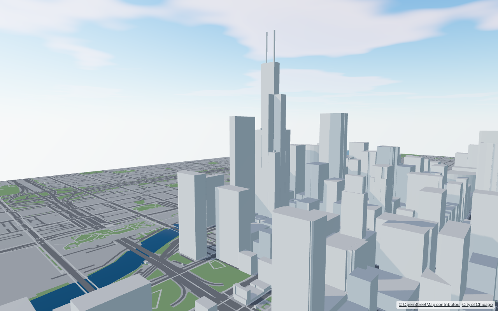
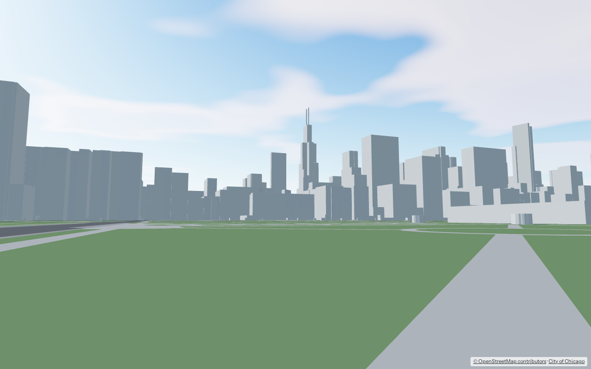

# Chicago Interactive Map

A 3D map of Chicago you can walk through in a browser, built only from open data and open-source tools.


**Status: phase 1, the Loop only.** Community area 32 (the Loop) is built: every building as a simple extruded block, plus streets, paths, parks, the river and Lake Michigan. You can fly over it like a map or walk through it at street level. The rest of the city comes next, one community area at a time.

| | |
|---|---|
|  |  |

## Quick start

You need **Docker** and **bash**. Everything else runs in containers. The first build downloads about 350 MB and uses about 1 GB of disk.

```bash
./dev build      # download sources and build the Loop (about 3 minutes the first time)
./dev app        # start the viewer
```

Open <http://localhost:5173>.

| Mode | Controls |
|---|---|
| **Map** | Drag to pan. Right-drag or two fingers to tilt and turn. Scroll or pinch to zoom. Click a building to see its height, where the height came from, and its OpenStreetMap link. |
| **Walk** | W A S D or arrow keys to walk, Shift to go faster. Click the view to look around with the mouse; Esc releases it. On a phone, use the circle at bottom left to walk and drag elsewhere to look. You can't walk through buildings. |

Click the minimap to jump somewhere. Viewpoints from [`eval/viewpoints.json`](eval/viewpoints.json) open with `?view=<name>`, for example <http://localhost:5173/?view=riverwalk>.

### Other commands

```bash
./dev build 32,8        # build several community areas (Loop + Near North Side)
./dev areas             # list all 77 community area numbers
./dev test              # pipeline tests and TypeScript check
./dev smoke             # click-a-building and walk-into-a-wall test in headless Chromium
./dev share             # public link via a Cloudflare quick tunnel (production build); ./dev unshare stops it
./dev eval              # screenshot every viewpoint into eval/out/ and check render budgets
./dev eval riverwalk    # just one viewpoint
./dev clean             # delete intermediate files and builds (downloads are kept)
```

## How it works

```
sources.yaml ──fetch──► data/raw/        downloads, recorded in sources.lock.json
                          │
                          ▼
             pipeline (Python, in Docker, run by Snakemake)
               osm        cut Chicago out of the Illinois OpenStreetMap extract
               buildings  footprints + heights, joined with City of Chicago attributes
               ground     streets, paths, water, parks, land (non-overlapping layers)
               tiles      one glTF tile per 500 m square, georeferenced 3D Tiles
                          │
                          ▼
                     data/builds/<build>/   tileset.json, tiles/*.glb, overview.json, report.json
                          │
                          ▼
             app (three.js + 3DTilesRendererJS, Vite)   map and walk modes in the browser
```

- **One community area at a time.** Chicago's 77 official community areas are the unit of work. `./dev build 32` builds only the Loop. Buildings are placed when their center falls inside the area. Ground layers extend two tiles past the area's edge, so the lake and parks don't stop at the boundary.
- **Heights** come from, in order: OpenStreetMap `height`, OpenStreetMap floor count, the City of Chicago floor count, then a default by building type. Each building records which source was used; you can see it in the building card. In the Loop, about 55% of buildings have real height data. Most of the rest are small structures (kiosks, station canopies, pavilions). Phase 2 replaces estimates with lidar.
- **Coordinates.** Everything is in meters from **State & Madison**, the zero point of Chicago's street address grid: x east, y north, z up. Tilesets carry the transform to Earth-centered coordinates, so other 3D Tiles viewers such as Cesium should be able to place them (not yet tested).
- **Builds are immutable folders.** `data/builds/manifest.json` says which one the viewer loads.

### Where things live

| What | Where |
|---|---|
| Code, config, viewpoints, agent progress | this repository |
| Source list with licenses | [`sources.yaml`](sources.yaml); exact files used in [`sources.lock.json`](sources.lock.json) |
| Downloads, intermediate files, tile builds | `data/` (not committed; rebuilt by the pipeline) |
| Progress of the neighborhood-by-neighborhood work | [`agent/state/areas.yaml`](agent/state/areas.yaml) |

## Data and licenses

| Source | Used for | License |
|---|---|---|
| [OpenStreetMap](https://www.openstreetmap.org/copyright), via the [Geofabrik](https://download.geofabrik.de/) Illinois extract | Buildings, streets, paths, water, parks | ODbL 1.0 · © OpenStreetMap contributors |
| [City of Chicago building footprints](https://data.cityofchicago.org/d/syp8-uezg) | Floor counts, year built, names, buildings missing from OSM | City of Chicago Data Portal Terms of Use |
| [City of Chicago community areas](https://data.cityofchicago.org/d/igwz-8jzy) | Build units and boundaries | City of Chicago Data Portal Terms of Use |

The viewer shows attribution for every source. Google and Apple map content (Street View, Look Around, Google 3D Tiles) is **not** used anywhere, not even as visual reference. Their terms forbid building map data from it. See [AGENTS.md](AGENTS.md#data-sources).

The project doesn't have a code license yet. Choose one before publishing the repository.

## Roadmap

| Phase | What | Status |
|---|---|---|
| 0 | Repo, Docker pipeline, source manifest, coordinate frame, viewpoint screenshots | Done |
| 1 | Simple blocks for buildings, streets, water and parks; map and walk modes; minimap | **Loop done; rest of the city next** |
| 2 | Accurate heights and roof shapes from USGS lidar; real ground elevation; accuracy report | Planned |
| 3 | Citywide generators for the L (track, elevated structure, stations) and trees; first neighborhood-walk pass that checks each area | Planned |
| 4 | Realistic rendering (materials, windows, reflections, sky; see [`demos/facade-layers.html`](demos/facade-layers.html)); facade recipes from Mapillary and KartaView photos | Planned |
| 5 | Live L trains, landmark photo captures, an in-app "report a problem" button, iOS and Android apps via Capacitor | Planned |

## Repository layout

```
dev                    task runner (bash)
docker-compose.yml     pipeline, web (viewer) and eval containers
sources.yaml           every data source, with license
pipeline/              Python package `cim`, Snakefile, config.yaml, tests
app/                   viewer: three.js, 3DTilesRendererJS, Vite, TypeScript
eval/                  viewpoints.json and the screenshot harness
agent/state/           neighborhood walk progress
demos/                 standalone rendering experiments
```
